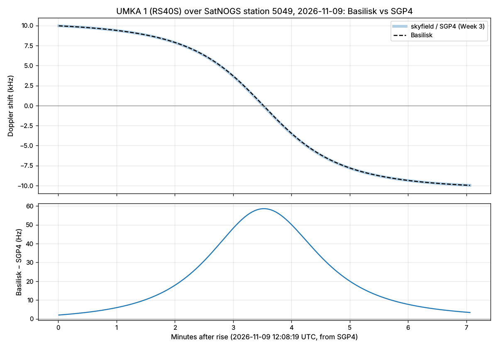
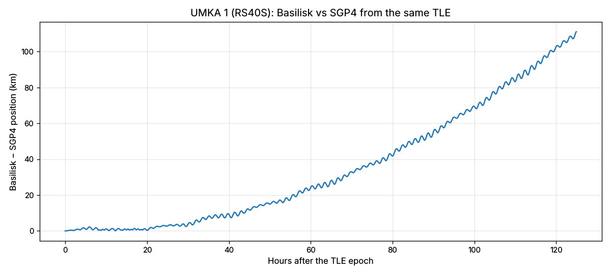
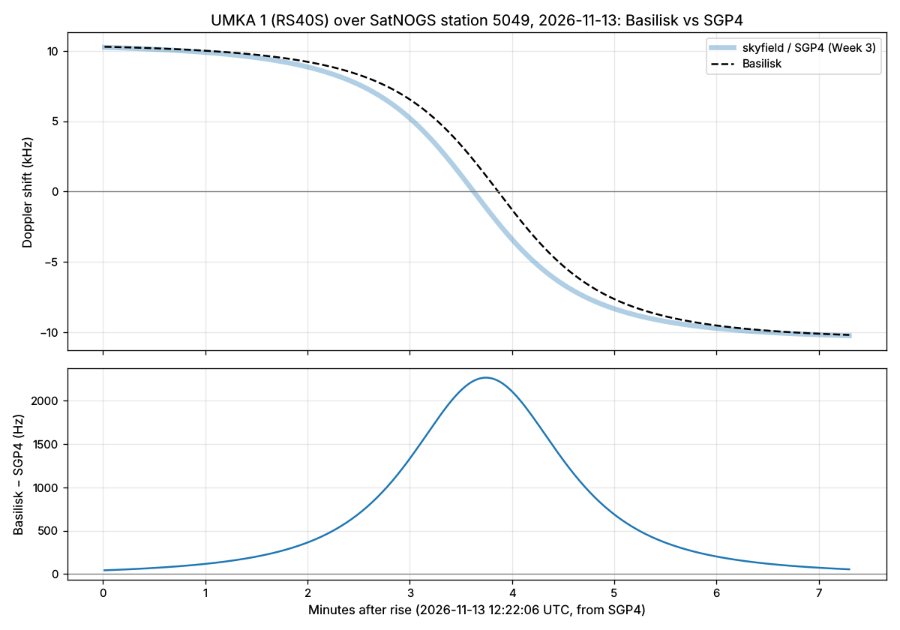

# Basilisk and Vizard: propagate the TLE and watch the pass in 3D

Weeks 1 to 3 used skyfield, which predicts the orbit with SGP4. This step hands the same
TLE to **Basilisk**, the spacecraft simulator from CU Boulder's Autonomous Vehicle Systems
lab, and shows the result in its 3D viewer, **Vizard**. Basilisk propagates the orbit by
integrating the forces on the satellite every second. That makes it a second, independent
prediction we can check SGP4 against. It also gives us a live demo for the presentation.

## What the script does

`basilisk_pass.py` follows the pipeline from our meeting: TLE → Basilisk → Vizard.

1. **TLE → starting state.** Basilisk's own `tleHandling` reads the TLE and turns it into
   a position and velocity at the TLE's epoch, in Basilisk's inertial frame.
2. **Propagation.** Basilisk's `spacecraft` module integrates the motion in 1-second steps
   (RK4). It includes:
   - the Earth's gravity field up to degree and order 10 (the GGM03S model), so the
     Earth's flattening and lumpiness pull on the orbit,
   - the Sun's pull.
3. **The ground station.** Basilisk's `groundLocation` module puts SatNOGS station 5049 on
   the rotating Earth. Every second it reports the satellite's elevation, range and
   **range-rate**, and whether the station can see it (above 10°).
4. **Earth's orientation and the Sun.** Basilisk normally reads these from NASA's SPICE
   files. Our script feeds them in from skyfield instead, through a small Basilisk module
   written in Python (`Environment`). That puts the station exactly where Weeks 2 and 3
   put it, so any difference from SGP4 comes from the orbit.
5. **Doppler.** The range-rate from `groundLocation` goes through the Week 3 formula,
   f_r = f_0 (1 − ρ̇ / c).
6. **Comparison and Vizard.** The script compares everything with skyfield/SGP4, and either
   saves the pass to a file you open in Vizard, or (`--live`) streams it to Vizard in real
   time.

## Results: the next day's highest pass

`python basilisk_pass.py --tle-file <the Week 3 TLE> --start 2026-11-08T23:15:17` used the
same TLE as Week 3 (epoch 2026-11-08 07:38:49 UTC) and took the highest pass of the next
day over station 5049: rise 2026-11-09 12:08:19 UTC, peak 50.3°, 1.19 days after the
TLE epoch.

| | Basilisk vs SGP4 |
|---|---|
| Starting position (at the TLE epoch) | **1.1 m** apart |
| After 1 hour | 0.36 km apart |
| After 1 day | 3.0 km apart |
| Rise and set | Basilisk **0.3 s** later |
| Peak elevation | 50.38° vs 50.34° |
| Doppler shift at rise / set | +9,967 / −9,976 Hz vs +9,965 / −9,979 Hz |
| Doppler difference | typically **14 Hz**, at most 59 Hz |



The two Doppler curves lie on top of each other. The difference (lower panel) peaks at
closest approach, because that is where the curve is steepest: about 127 Hz per second on
this pass. A satellite that is late by a fraction of a second shows up most there, and the
59 Hz peak is what about half a second gives. Basilisk's satellite is a few kilometers
behind SGP4's after a day, and at 7.6 km/s, 3 km is about 0.4 s.

**Checkpoint: PASS.**
- Basilisk's starting state matches SGP4's to 1.1 m. Basilisk's TLE reader and skyfield
  both run SGP4 at the epoch, then rotate from SGP4's TEME frame with slightly different
  formulas.
- `groundLocation`'s range-rate agrees with the Week 3 dot product, worked out on
  Basilisk's own orbit, to better than 0.001 mm/s. Basilisk's ground station and our
  formula do the same physics.
- The shift starts positive and ends negative.

## Results: five days out, and why the orbits drift apart

With `--days 7`, the highest pass is Week 3's 82.3° pass, **5.2 days** after the TLE epoch.
There the two predictions no longer agree:

| | Basilisk vs SGP4 |
|---|---|
| Position at the pass | **111 km** apart |
| Rise and set | Basilisk **14 s** later |
| Peak elevation | 83.03° vs 82.34° |
| Doppler difference | typically 330 Hz, at most 2.3 kHz |





Five days out, Basilisk's curve is the same shape but 14 s late, so near closest
approach, where the shift changes by about 159 Hz every second, the two curves are up to
2.3 kHz apart.

The gap grows with the square of time. That is the signature of **atmospheric drag**,
which our Basilisk run leaves out:

- Drag takes energy from the orbit, so the satellite sinks lower. A lower orbit is faster,
  so the satellite gets further and further ahead of where it would be without drag.
- SGP4 includes drag through the TLE's drag terms. Basilisk, as we set it up, does not.
- The TLE says how fast the mean motion is changing: its first-derivative field is
  0.00010117 rev/day², which is half the rate. Over t minutes that puts the satellite
  ndot × t² radians ahead. For 5.21 days that comes to **118 km**, close to the 111 km
  Basilisk falls behind. (The script prints this estimate as "Drag estimate".)

UmKA-1 orbits at about 500 km, low enough that drag matters, especially with the Sun near
the peak of its 11-year cycle.

So Basilisk is precise about the forces it models, but it only knows about forces we add.
Starting from a TLE, a prediction can't be better than the TLE itself, which is why fresh
TLEs matter (the plan's "old TLEs" warning). For passes within a day, Basilisk and SGP4
agree to under a second. Adding drag to Basilisk is the natural next step (see below).

## What you see in Vizard

- The Earth turning, lit by the Sun, with UmKA-1 and its orbit.
- **SatNOGS 5049** as an orange marker in Kitakyushu, with a cone showing the sky above
  10° elevation, the part of the sky where the station can hear the satellite.
- A **line from the station to the satellite** whenever the satellite is inside that cone.
- The **437.625 MHz beacon** lighting up while the station can hear it. (The real beacon
  is always on. Lighting it only during the pass shows when the station receives it.)
- A camera panel, **"Looking down from Umka-1"**, that looks straight down from the
  satellite, so you can watch Japan and the station pass underneath.
- A clock showing the real date and time (UTC) of the pass.

## Running it

Install Basilisk once:

```bash
pip install bsk
```

Basilisk downloads its Earth gravity file from GitHub the first time it runs.

```bash
python basilisk_pass.py                 # highest pass in the next day, compared with SGP4
python basilisk_pass.py --days 7        # highest pass in the next 7 days
python basilisk_pass.py --tle-file my.tle --start 2026-11-08T23:15:17   # reproduce a run
python basilisk_pass.py --degree 2      # J2 only, to see what the extra gravity terms do
```

The plots go to `data/plots/` (`basilisk_drift_*.png`, `basilisk_doppler_*.png`), and the
Vizard file to `data/vizard/pass_<NORAD>_<station>.bin`. It holds the pass plus 5 minutes
either side, with the time it all happened.

**Getting Vizard.** Vizard is a separate app (macOS, Linux or Windows), downloaded from
Basilisk's documentation site under *Vizard → Download*. Unzip it and open it. To play
back a saved pass, choose file playback on Vizard's start screen and open the `.bin` file.

## Live, in real time (the demo)

```bash
python basilisk_pass.py --live               # real time from now, streamed to Vizard
python basilisk_pass.py --live --speed 20    # 20 times faster than real time
python basilisk_pass.py --live --no-viz      # real-time status lines only
python basilisk_pass.py --live --start 2026-11-09T12:05:00 --speed 10   # replay a pass
```

With `--live`, the script:

1. starts Basilisk from the TLE's epoch and runs it as fast as it can until it reaches the
   current time. This "catch-up" takes about 15 seconds per day since the epoch,
2. then switches on Basilisk's `ClockSynch` module, which slows the simulation down to
   match the wall clock (or `--speed` times it), and
3. streams every step to Vizard, and every 10 seconds prints the time, where the satellite
   is, its elevation from the station and, during a pass, the Doppler shift. The SGP4
   elevation is printed alongside as a check.

Start Vizard first and choose live streaming on its start screen, at the address the
script prints: `tcp://localhost:5556`. Basilisk waits until Vizard connects.

For the presentation, either run `--live` at a time when a pass is coming up, or replay a
pass with `--start` a few minutes before its rise and `--speed 10`.

Example status lines from a replay of the 12:08 UTC pass (`--start 2026-11-09T12:05:00
--speed 30 --no-viz`):

```
2026-11-09 12:08:00 UTC  lat +20.12  lon +138.20  alt 496.1 km  elev  +8.2°  (SGP4 elev  +8.1°)
2026-11-09 12:09:00 UTC  lat +23.91  lon +137.38  alt 496.9 km  elev +14.9°  IN VIEW  Doppler   +9640 Hz  (SGP4 elev +14.8°)
2026-11-09 12:11:00 UTC  lat +31.48  lon +135.61  alt 498.7 km  elev +40.4°  IN VIEW  Doppler   +5510 Hz  (SGP4 elev +40.4°)
2026-11-09 12:12:00 UTC  lat +35.26  lon +134.65  alt 499.9 km  elev +49.8°  IN VIEW  Doppler   -1206 Hz  (SGP4 elev +49.8°)
2026-11-09 12:14:00 UTC  lat +42.79  lon +132.50  alt 502.3 km  elev +21.1°  IN VIEW  Doppler   -9019 Hz  (SGP4 elev +21.2°)
```

The live elevation comes from `groundLocation`, which measures from the line to the
Earth's center. The comparison above uses the WGS84 vertical, like Weeks 2 and 3. At 34°
latitude the two differ by about 0.19°, which is why the live lines can differ from SGP4
by 0.1° even when the orbits agree.

## If CelesTrak or SatNOGS can't be reached

The `Basilisk - propagate the TLE and save the pass for Vizard` GitHub Actions workflow
runs the script with a fresh TLE whenever `basilisk_pass.py` changes, or by hand from the
Actions tab. The results are in the job log and the `basilisk-results` artifact, which
includes the Vizard `.bin` file to download and open.

## Not tested here

The Vizard app itself wasn't run while writing this (it needs a screen). Writing the
`.bin` file, the live mode's wait for Vizard, and the real-time pacing were all checked.
The first time you open the file or connect live, check the camera panel and the station
cone, and adjust `add_vizard()` in the script if something looks off.

## Next steps

- **Add drag to Basilisk.** Basilisk has a drag module (`dragDynamicEffector`) and
  atmosphere models. Matching the TLE's decay rate would close most of the 5-day gap.
- **Compare with a real recording.** Overlay the Basilisk Doppler curve on a SatNOGS
  waterfall of the same pass, to see what the prediction looks like next to what the
  station actually heard.
- **Feed the Week 5 dataset generator.** Basilisk can produce the "true" orbit for the
  training data, with SGP4 standing in for the station's slightly wrong prediction.
