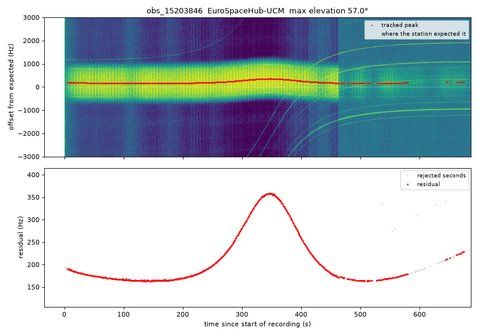
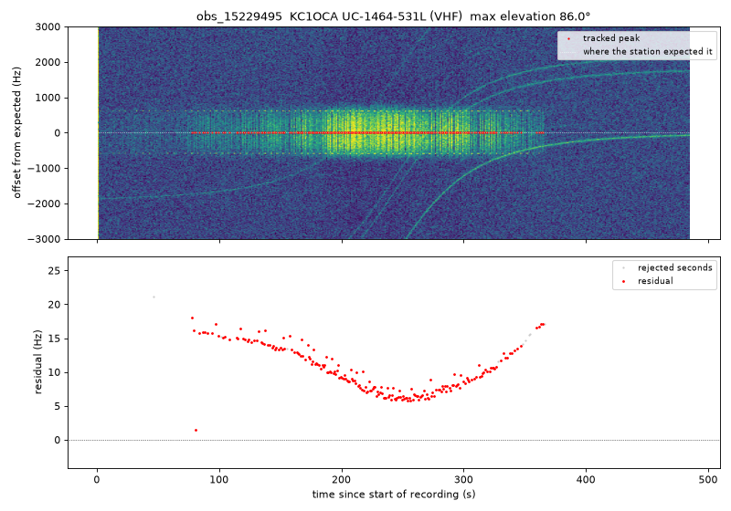
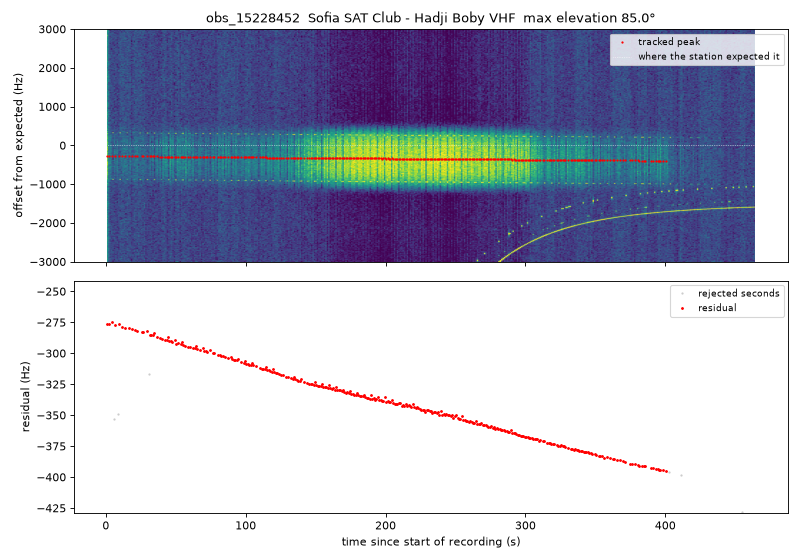

# Week 3: Tracking the signal and measuring the residual

This page explains what `track_peaks.py` does and why, in plain language, and shows
what it found on real FUNcube-1 passes.

## The idea in one paragraph

FUNcube-1 transmits at a fixed frequency, 145.935 MHz. As it flies over a ground
station, the **Doppler effect** changes the frequency the station hears: higher while
the satellite approaches, lower once it moves away, just like an ambulance siren. The
station predicts this shift from the satellite's **TLE** (its published orbit) and
its own location, and removes it. If every prediction were perfect, the corrected
signal would sit exactly on 145.935 MHz the whole time. It never does. What's left
over is the **residual**:

> **residual = the frequency we actually heard − the frequency the station expected**

The residual is the clue we'll use later to work out where the satellite really is
and how fast it's moving. This week's job was to **measure it**, second by second,
for every good pass.

## Step 1: Where is "expected" in the recording?

SatNOGS recordings are audio files, not radio frequencies. So we needed to know how
SatNOGS turns the radio signal into sound. Reading the station software's source
code ([`generic/bpsk.grc`](https://gitlab.com/librespacefoundation/satnogs/satnogs-flowgraphs/-/blob/master/generic/bpsk.grc)
in satnogs-flowgraphs) gave the answer:

1. the station removes the **predicted** Doppler shift,
2. then slides everything up by **exactly 12,000 Hz** so that it becomes audible sound.

So in the audio, **12,000 Hz means "exactly where the station expected the
satellite"**, and

> **residual = (pitch of the satellite in the audio) − 12,000 Hz**

This matches what we see. FUNcube-1's signal sits between about 11,450 and
12,250 Hz in the audio on every pass we looked at, so residuals are a few hundred Hz.

## Step 2: Finding the peak precisely

FUNcube-1 sends its data with **BPSK**: it flips the wave upside down to send each
bit. Those flips smear the signal's energy over about 2 kHz, so there's no single
sharp peak to point at. (That's why it looks like a wide stripe in the waterfall.)

A standard radio trick fixes this: **multiply the signal by itself (square it)**.
An upside-down wave squared is the same as a right-way-up wave squared, so squaring
erases the bit flips. What's left is **one very sharp peak at exactly twice the
signal's offset**, and we just halve its position.

For every second of the recording, the script then:

1. finds the tallest peak within ±3 kHz of "expected",
2. pinpoints it **between** frequency bins by fitting a small parabola through the
   peak and its two neighbours (a common numerical-methods trick),
3. keeps it only if it's clearly above the noise (at least 10 dB),
4. checks that it isn't a steady tone from something else. BPSK never has a sharp
   peak *before* squaring, but interference does, so such peaks are skipped,
5. keeps only the points that join up smoothly into one track. If the satellite's
   signal fades out, the script won't jump to some other signal that happens to be
   in the recording.

On strong passes, consecutive seconds agree to within about **half a hertz**, out of
146 million. That's precise enough to see small effects.

## Step 3: What comes out

For every `SIGNAL` pass in `validation_report.csv`, the script writes to
`data/39444/peak_tracks/`:

| File | What's in it |
|---|---|
| `obs_<id>.csv` | one row per second: UTC time, frequency in the audio, **residual (Hz)**, peak strength, and whether that second was used |
| `obs_<id>.png` | top: the signal around "expected" with the tracked peak in red; bottom: **the residual over time** |
| `residual_summary.csv` | one row per pass: station, average residual, how much it changed during the pass, how steady the track was |

```bash
python track_peaks.py data/39444            # every SIGNAL pass
python track_peaks.py data/39444 --all      # also try the rejected ones
```

## How to read a residual plot

* **A flat line away from zero** (for example, always +170 Hz): the station's radio
  is tuned slightly off. That's very common. 1 part per million at 146 MHz is
  146 Hz. It's different for every station, which is what the mentor predicted.
* **A slow slope**: the station's radio drifting as it warms up, or a slightly wrong
  satellite position.
* **A bump or an S-shape around the middle of the pass**: the interesting one. The
  middle of the pass is the **time of closest approach**, when the Doppler shift
  changes fastest. So that's when any error in the predicted Doppler shows up most.
  It means the TLE (where the satellite really is), the station's location, or the
  station's clock is slightly off. Working out which one is the next phase of the
  project.

## Results

On **12 FUNcube-1 passes from 7 stations** (downloaded Oct 18 with the fixed script,
all checked as `SIGNAL`):

| Pass | Station | Max elevation | Seconds tracked | Typical residual | Change during pass | Slope |
|---|---|---|---|---|---|---|
| 15203846 | EuroSpaceHub-UCM | 57° | 518 / 687 | +179 Hz | 186 Hz | +6 Hz/min |
| 15222420 | JH4XSY-pi | 64° | 109 / 285 | -442 Hz | 36 Hz | +14 Hz/min |
| 15228423 | JH4XSY-pi | 88° | 16 / 274 | -452 Hz | 13 Hz | +13 Hz/min |
| 15237439 | JH4XSY-pi | 64° | 13 / 257 | -465 Hz | 20 Hz | +18 Hz/min |
| 15229495 | KC1OCA | 86° | 205 / 486 | +10 Hz | 10 Hz | -1 Hz/min |
| 15236162 | OZ9AEC | 36° | 192 / 254 | -52 Hz | 38 Hz | -12 Hz/min |
| 15222456 | Sofia SAT Club | 73° | 289 / 465 | -330 Hz | 102 Hz | -18 Hz/min |
| 15228452 | Sofia SAT Club | 85° | 326 / 465 | -341 Hz | 102 Hz | -18 Hz/min |
| 15230978 | Sofia SAT Club | 67° | 246 / 440 | -403 Hz | 5 Hz | +0 Hz/min |
| 15236149 | VU2JEK_Nitin | 41° | 611 / 702 | -307 Hz | 238 Hz | -24 Hz/min |
| 15228653 | gerrits station | 45° | 414 / 426 | -510 Hz | 29 Hz | -5 Hz/min |
| 15228655 | gerrits station | 44° | 386 / 442 | -487 Hz | 111 Hz | -17 Hz/min |

The 3 JH4XSY-pi passes were weak and gave only short tracks (13–109 seconds); treat
those numbers with care. Every other track follows the signal for most of the pass.

**What stands out**

1. **Each station has its own offset, and it repeats.** Gerrit's station is about
   −490 to −510 Hz on both of its passes, and Sofia's about −330 to −400 Hz on all
   three. KC1OCA is within 20 Hz of zero, so it's well calibrated. This is the
   per-station error the mentor predicted. It's mostly each station's radio being
   tuned slightly off, so we'll need to estimate it separately for each station.
2. **Several passes slope downward**, by 12–24 Hz per minute, at stations in
   different countries (Sofia twice, Gerrit, VU2JEK, OZ9AEC). Others are flat, and the
   weak JH4XSY passes slope slightly upward. A slope shared across stations could
   come from the satellite itself (for example, its transmitter drifting as it heats
   up in sunlight) or from the TLE; a station's own radio warming up is another
   possibility. To be checked in the next phase, with more passes.
3. **Shapes centred on closest approach.** Pass 15203846 has a smooth **bump** of
   about +190 Hz at closest approach, and pass 15229495 (almost straight overhead)
   has a small **dip** of about 10 Hz. These are the effects of a slightly wrong
   predicted Doppler shift, and exactly what the position and velocity work will use.


*Pass 15203846 (EuroSpaceHub-UCM, Spain): constant offset of about +165 Hz and a
bump at closest approach (~350 s). After ~460 s the signal fades and the track stops
rather than jumping to the other signals visible in the top panel.*


*Pass 15229495 (KC1OCA, USA, 86° elevation): a well-calibrated station, with residuals
under 20 Hz and a small dip at closest approach.*


*Pass 15228452 (Sofia SAT Club, Bulgaria): a steady downward slope of about 17 Hz per
minute.*

**How precise is it?** Tested on fake recordings where the true residual is known
(`tests/test_track_peaks.py`), the tracker is within **1 Hz** of the truth (median),
including an S-shaped residual that swings 200 Hz. On real strong passes, neighbouring
seconds agree to about **0.5 Hz**. Pure noise gives no track, and a steady interfering
tone next to the signal isn't followed.

## Limitations and next steps

* **Two causes are mixed together.** The residual includes both the station's radio
  being off-tune (roughly constant) and the orbit/location errors (changing over the
  pass). Separating them needs the Doppler maths: computing the satellite's predicted
  path from the TLE (for example with the `skyfield` Python library) and fitting.
* **Assumption:** every station uses the 12,000 Hz shift from the current software.
  Stations on older software (1.8.x) show FUNcube-1 in the same place, so it looks
  right, but it hasn't been confirmed in their code.
* **Data:** the old files in `data/wrong_satellite/` were never FUNcube-1 (old download
  bug). Only use passes downloaded with the fixed script.
