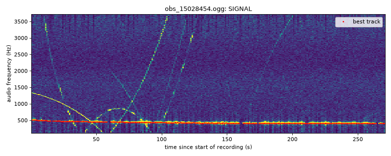
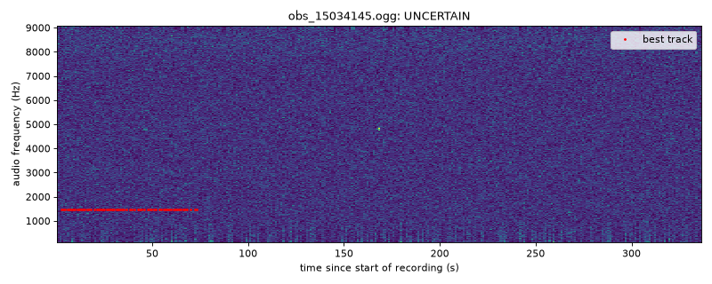
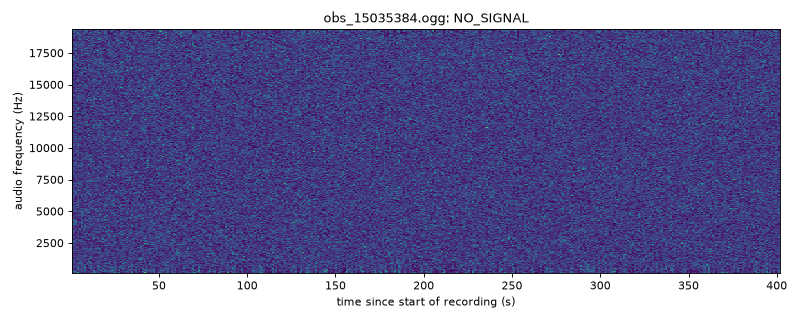

# Week 2: Pass metadata + automatic signal validation

This page explains, in plain language, what the new code does, why, and what it found
on the 10 FUNcube-1 passes we already downloaded.

## The big picture (why we're doing this)

Volunteer ground stations around the world record satellites as they fly overhead
(a "pass") and upload the recordings to [SatNOGS](https://network.satnogs.org).
Each station uses a **TLE** (a standard two-line summary of the satellite's orbit)
to predict where the satellite is. From that it predicts how the radio frequency
will shift (the **Doppler effect**, the same effect that changes an ambulance
siren's pitch as it passes) and corrects for it.

If the TLE were perfect, the corrected signal would sit at one fixed pitch. In
practice it doesn't. The small leftover drift (the **residual**) is the difference
between what was *expected* and what was *observed*. Later in the project we'll use
those residuals to estimate the satellite's real position and velocity.

For that we need three things for every pass:

1. the recording,
2. **where the ground station is** (latitude, longitude, altitude), and
3. **the TLE the station used**,

plus confidence that the recording **actually contains the satellite's signal**. If we
measure the residual on a recording that's only noise, we'll get garbage numbers
that look real.

## What changed

### 1. `download_funcube.py` now saves metadata

For every pass it now writes three kinds of file into `data/<NORAD ID>/`:

| File | What it holds |
|---|---|
| `obs_<id>.ogg` | the audio recording (same as before) |
| `obs_<id>.json` | **the complete SatNOGS record**, including `station_lat`, `station_lng`, `station_alt`, `tle0/1/2`, transmitter frequency, start/end time, max elevation, and more |
| `manifest.json` | one summary row per pass with the important fields, so you don't have to open every JSON file |

Other improvements:

* **Any satellite**: pass `--norad <ID>`. Each satellite gets its own folder, because we'll
  work with more than one satellite.
* **"Recent" now means recent**: by default it only takes passes that started in the
  **last 24 hours** (`--hours` changes that), counted back from *now*. The old version
  used a 3-day window.
* It warns you if a pass is missing the station location or TLE.
* When the download finishes it **automatically runs the signal check**, so nothing is
  done by hand. (`--skip-validation` turns this off.)

### 2. New `validate_signals.py`: does each recording really have a signal?

Think of the recording as a song. The script turns it into a **spectrogram**, a
picture with time on the x-axis and pitch (frequency) on the y-axis. Bright means
loud. Pure noise looks like TV static. A satellite shows up as a **thin bright line**,
and because of the residual Doppler that line bends slowly over the pass.

The check works in four steps:

1. **Find bright spots.** For each second of audio it measures the local "static
   level" and marks only the spots that are *much* brighter than it.
2. **Connect the dots.** Bright spots in consecutive seconds are joined into a
   *track* if the pitch changes only a little between them, the way a real signal
   drifts. Random noise spots don't line up, so they never form a long track.
3. **Judge the best track.** To count as a signal it must:
   * last at least **20 seconds**, be present in **at least half** the seconds it
     spans, and be clearly above the noise;
   * drift **slowly** (less than 1.5 Hz per second). SatNOGS already removed the
     predicted Doppler, so a fast-moving line is usually a *different* satellite
     passing through the same band;
   * be **smooth**, not jumpy;
   * **not** stay at exactly one pitch the whole time. A perfectly flat line is
     more likely interference from something near the station than the satellite.
4. **Quality checks.** The script also looks for audio dropouts (gaps of silence),
   very short recordings, SatNOGS's own "without-signal" rating, and missing
   metadata.

Each pass gets one of three verdicts:

| Verdict | Meaning | Used later? |
|---|---|---|
| `SIGNAL` | clear, well-behaved satellite-like track | **yes** |
| `UNCERTAIN` | something is there, but a warning sign is present | no |
| `NO_SIGNAL` | nothing convincing | no |

**It's strict on purpose.** As discussed in the meeting, a false "yes" (accepting
noise) would poison the orbit analysis. A false "no" only costs one pass, so
anything doubtful is rejected.

The script writes:

* `validation_report.csv`: one row per pass with the verdict, the reasons, signal
  strength (SNR), start/end frequency of the track, drift rate, duration, file size,
  and the station location;
* `validation_plots/obs_<id>.png`: the spectrogram with the detected track in red,
  so a human can double-check any verdict in a couple of seconds.

**Machine-learning screen.** The partner's CNN waterfall classifier now runs first;
see [Update: CNN screen + wide-signal detector](#update-cnn-screen--wide-signal-detector-oct-18).

### 3. Tests (`tests/`)

We can't know the right answer for real recordings, so the tests use **fake
recordings where we do know it**: pure noise, noise plus a weak drifting tone, a tone
that's too short, a constant interference tone, a recording with gaps, and another
satellite sweeping across the band. Results:

* **Pure noise: 0 false alarms in 25 separate noise recordings** (5 in the test suite
  and 20 more in a separate run).
* A drifting tone is detected when it is at least about **5% of the noise amplitude**
  (roughly 5 dB above the noise in a 6 Hz slice). Below that, it's rejected.
* Constant tones, recordings with gaps, and a crossing satellite are all kept out of
  `SIGNAL`.
* The downloader's pass-picking logic is tested against a fake SatNOGS response.
  It skips passes that are too old, too close together, missing audio, or have the
  wrong status, and it saves the location and TLE.

Run them with `python -m pytest tests/`.

## Results on our 10 FUNcube-1 passes

| Pass | Verdict | Why |
|---|---|---|
| 15028454 | **SIGNAL** | smooth line from 510 to 398 Hz for 257 s, drifting −0.30 Hz/s, 22 dB above the noise |
| 15034145 | UNCERTAIN | line at exactly 1465 Hz for 63 s with zero drift, so it could be interference |
| 15026718, 15026767, 15030415, 15035384 | NO_SIGNAL | nothing above the noise |
| 15033065, 15034070, 15034244, 15034713 | NO_SIGNAL | only short fragments (3–13 s); 15034244 and 15033065 also have audio dropouts |

**So only 1 of 10 passes survives**, even though SatNOGS had rated all 10 as "good".

Example plots (red dots = detected track):


*Pass 15028454: the slowly bending red line is the kind of residual drift we'll use
later. The steep curves are other signals sweeping through; the checker ignores them.*


*Pass 15034145: a perfectly flat tone. It might be the satellite, but it might be local
interference, so it's rejected.*


*Pass 15035384: static only.*

### What this tells us

* **We should download many more than 10 passes.** Expect roughly 1 in 10 (this is a
  very small sample) to be usable, so aim for 50 to 100 per satellite.
* **SatNOGS's "good" rating isn't enough on its own.** A "good" rating says the
  observation worked by SatNOGS's standards. It doesn't guarantee a signal clean
  enough to measure frequency drift.
* **Known limitation (now fixed):** the checker only looked for *thin* lines, so it
  missed FUNcube-1's *wide* data signal. See the update below.

## Missing metadata for the 10 existing passes

Those 10 files were downloaded with the old script, which didn't save metadata. From
this sandbox SatNOGS couldn't be reached (blocked by network policy), so I couldn't
fetch it. Running `python download_funcube.py` on your own computer will download
fresh passes with full metadata. The 10 old files have been moved to `data/39444/`
to match the new layout.

## Data size (for the storage question)

* Measured: **about 1 MB per minute of audio**. A 4–8 minute pass is **2–15 MB**, and our
  10 passes total **58 MB**.
* 100 passes per satellite ≈ 0.6 GB. Ten passes a day for a month ≈ 1.7 GB per satellite.
* GitHub isn't meant for this: those `.ogg` files are currently committed to git
  (58 MB), which makes the repo slow to clone and can't be undone without rewriting
  history.
* Options to look into:
  * **Don't store the audio ourselves.** SatNOGS already keeps every recording
    (its archive is on archive.org, which is what the `archive_url` field points to).
    We could keep only the small `manifest.json` and metadata, plus our results, and
    re-download audio on demand. Metadata is a few KB per pass and fits fine in
    GitHub.
  * **Zenodo** (CERN): free for research data, gives a citable DOI, and allows large
    uploads per record.
  * **Kaggle Datasets / Hugging Face Datasets**: free public dataset hosting.
  * **Google Drive** (the mentor's suggestion): simplest for sharing within the team.

  Check each service's current size limits before choosing.

## How to run everything

```bash
pip install -r requirements.txt
python download_funcube.py                 # download + validate, FUNcube-1, last 24 h
python download_funcube.py --count 50 --hours 48
python validate_signals.py data/39444      # re-check a folder on its own
python -m pytest tests/                    # run the tests
```

## Update: CNN screen + wide-signal detector (Oct 18)

### Why

Two questions: is the partner's CNN waterfall classifier
([tlofbj/waterfall-classifier-project-v3.5cnn-lite](https://github.com/tlofbj/waterfall-classifier-project-v3.5cnn-lite))
better than our checker, and why does our checker accept so few passes?

We tested both on **40 FUNcube-1 passes**: our 10 plus 15 that SatNOGS volunteers rated
"with signal" and 15 rated "without signal". Each waterfall was also labelled **by
eye**: 16 have a clear FUNcube-1 signal, 17 are empty, and 7 are too ambiguous to call,
so they're left out of the scores. The eye labels agreed with SatNOGS's rating on
27 of 29. One pass rated "without signal" (15221275) has an obvious strong signal.

### What we found

* **The CNN, as shipped, says "signal" for every pass.** Its cut-off is 0.5, but even
  empty FUNcube-1 waterfalls score about 0.59. Its 95.5% accuracy is logged for an
  older model file (2025-04-23), not the one in the repo (2025-05-08). Its
  *ranking* is still useful (AUC 0.90; 1.0 would be perfect), so we kept it with a new
  cut-off of **0.60**.
* **Our checker was looking for the wrong shape.** In the audio, FUNcube-1's BPSK
  telemetry is a **steady band about 1 kHz wide** (near 11.5 kHz for most stations),
  not a thin line. Peaks inside the band jump around, so the thin-line tracker
  either fell apart or locked onto thin curves from *other* satellites.

### What changed

1. **`waterfall_cnn.py`** is the partner's network and preprocessing, unchanged (MIT
   licence, credit in the file), with the new 0.60 cut-off. It runs first on each
   pass's waterfall image. Below 0.60 the pass is rejected. Above it, the audio check
   decides, so a high CNN score alone never makes a pass `SIGNAL`. Without PyTorch
   installed, it's skipped.
2. **Wide-signal detector** in `validate_signals.py`: it averages power over 800 Hz
   bands and looks for one that is **louder than the surrounding spectrum, at the same
   audio frequency, for at least half the recording, by at least 3 dB**. A weaker band
   (at least 30% of the recording and 1.5 dB) gives `UNCERTAIN`. The thin-line
   tracker is still used for passes without a wide band.
3. **`download_funcube.py`** now also saves `obs_<id>_waterfall.png`. It also had a
   **bug**: the API filter `satellite__norad_cat_id` is silently ignored, so it could
   download passes of *other satellites*. It now uses `norad_cat_id` and double-checks
   each record's NORAD ID.

### Results on the 33 clearly-labelled passes

| | Real signals marked `SIGNAL` | Empty passes marked `SIGNAL` |
|---|---|---|
| Old audio checker | 4 / 16 | 0 / 17 |
| Partner's CNN at 0.5 | 16 / 16 | **17 / 17** |
| Partner's CNN at 0.60 (screen only) | 16 / 16 | 8 / 17 |
| **New pipeline (CNN screen + audio check)** | **14 / 16** | **0 / 17** |

The 2 real signals still not accepted are `UNCERTAIN`, not lost silently. In both, the
wide band is weak and the checker locked onto a drifting thin line instead.
The CNN screen also rejects about half the empty passes before the slower audio
check runs (~0.04 s vs ~9 s per pass).

The wide-signal detector gave **0 false alarms on 20 extra pure-noise recordings**,
and the test suite has new synthetic cases: a FUNcube-like band (accepted), a band
too faint to trust (not accepted), and the CNN screen in both directions.

**Caveat:** both cut-offs were chosen using these same 40 passes, so the numbers
above are optimistic. Check them on a fresh batch of passes, ideally from more
ground stations, before trusting them fully.

The report CSV now includes `cnn_score`, `wide_freq_hz`, `wide_fill` and
`wide_excess_db`. `wide_freq_hz` is where the signal sits in the audio, which is
the starting point for the next step: tracking the peak through the pass.
