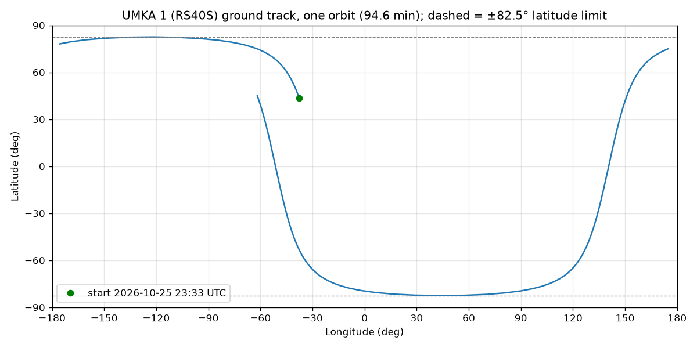

# Week 1: pick a satellite and find it

## The satellite: UmKA-1

| | |
|---|---|
| NORAD catalog number | **57172** |
| Beacon | CW, **f_0 = 437.625 MHz** (active on SatNOGS DB) |
| Orbit | sun-synchronous, inclination 97.49°, about 500 km, period 94.6 min |

Chosen on SatNOGS DB on 2026-10-25. It has an active CW beacon, a 300–1,000 km orbit, and
25+ good SatNOGS Network observations in the week before. Among the satellites that matched,
it has the highest beacon frequency, so it gives the biggest Doppler shift (about ±10 kHz).

**Second satellite on another band** (for Week 5): SONATE-2, NORAD 59112, CW at 145.840 MHz.

Before Week 4, open a few UmKA-1 waterfalls on SatNOGS Network to confirm the CW line is
visible. A "good" observation means some signal was heard, not necessarily the beacon.

## Where it is

```
$ python find_satellite.py
Satellite   : UMKA 1 (RS40S) (NORAD 57172), f_0 = 437.625 MHz
TLE         : 1 57172U 23091G   26298.71045447  .00003759  00000+0  16711-3 0  9998
              2 57172  97.4896 356.9021 0012962  30.6783 329.5208 15.22062440183850
TLE epoch   : 2026-10-25 17:03:03 UTC (0.27 days old)
Orbit       : inclination 97.49 deg, period 94.6 min
Now         : 2026-10-25 23:33:15 UTC
Position    : lat +43.6902 deg, lon -37.6827 deg, alt 497.6 km
Checkpoint  : PASS
```

**Checkpoint.** The altitude, 497.6 km, is within 300–1,000 km. The orbit is tilted past
90°, so the latitude limit is 180° − 97.49° = 82.5°, and +43.7° is inside it.

## Stretch: ground track for one orbit



The track touches the ±82.5° limit (dashed) and never crosses it. Each orbit ends about 24°
west of where it started, because Earth turns 360° × 94.6 / 1436 ≈ 23.7° underneath it.
