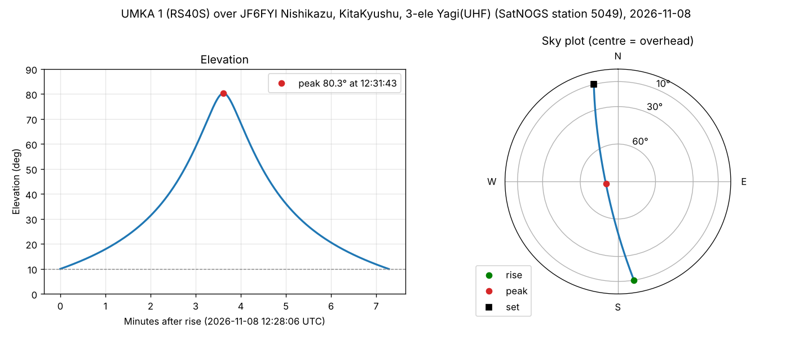

# Week 2: put down a ground station and predict passes

## The station: SatNOGS 5049 (JF6FYI, Kitakyushu, Japan)

| | |
|---|---|
| SatNOGS station | **5049**, "JF6FYI Nishikazu, KitaKyushu, 3-ele Yagi (UHF)", online |
| Location | **+33.895° N, +130.840° E, 10 m** |
| Horizon set on SatNOGS | 0° |
| Recent UmKA-1 observations | **16 good** in the 7 days to 2026-11-02, the most of any station |

**How it was chosen.** `python predict_passes.py --find-station` read SatNOGS Network's
good UmKA-1 observations from the last 7 days, counted them per station, and took the
busiest station that is online. The next busiest were stations 4084, 2173 and 2107, with
12 good observations each. Because station 5049 hears UmKA-1 often, later projects will
have plenty of real recordings to compare against. The station is now the default in
`predict_passes.py` (`STATION_ID = 5049`).

In the code, the station is `wgs84.latlon(33.895, 130.840, elevation_m=10)`. That is a
point fixed to the Earth's surface, so skyfield turns it with the Earth.

## Passes in the next 7 days

Run on 2026-11-02 at 01:01 UTC, with a TLE 0.23 days old (epoch 2026-11-01 19:27 UTC),
counting a pass from when UmKA-1 climbs above 10°. All times are UTC; Japan is UTC+9.

```
  #  rise (UTC)           culminate  set       minutes  peak elev
  0  2026-11-02 11:22:22  11:23:43  11:25:05      2.7      11.8°
  1  2026-11-02 12:53:49  12:57:05  13:00:24      6.6      32.5°
  2  2026-11-03 00:26:37  00:29:44  00:32:50      6.2      24.9°
  3  2026-11-03 02:00:54  02:03:13  02:05:33      4.6      16.0°
  4  2026-11-03 12:33:39  12:37:14  12:40:52      7.2      65.3°
  5  2026-11-04 00:07:50  00:09:49  00:11:47      4.0      13.9°
  6  2026-11-04 01:40:20  01:43:32  01:46:44      6.4      28.0°
  7  2026-11-04 12:13:52  12:17:26  12:21:02      7.2      62.0°
  8  2026-11-05 01:20:10  01:23:48  01:27:25      7.2      52.9°
  9  2026-11-05 11:54:26  11:57:41  12:00:57      6.5      31.6°
 10  2026-11-05 13:30:11  13:31:28  13:32:46      2.6      11.5°
 11  2026-11-06 01:00:17  01:04:00  01:07:42      7.4      77.8°
 12  2026-11-06 11:35:28  11:37:58  11:40:28      5.0      17.8°
 13  2026-11-06 13:08:42  13:11:30  13:14:21      5.6      21.1°
 14  2026-11-07 00:40:38  00:44:08  00:47:37      7.0      38.8°
 15  2026-11-07 02:16:36  02:17:27  02:18:18      1.7      10.6°
 16  2026-11-07 12:48:11  12:51:35  12:55:02      6.9      39.3°
 17  2026-11-08 00:21:20  00:24:13  00:27:05      5.8      21.1°
 18  2026-11-08 01:55:07  01:57:46  02:00:25      5.3      18.8°
 19  2026-11-08 12:28:06  12:31:43  12:35:23      7.3      80.3°
 20  2026-11-09 00:02:53  00:04:14  00:05:35      2.7      11.6°
```

There are 21 passes, in two groups each day: one around 00:00–02:00 UTC (morning in Japan)
and one around 11:30–13:30 UTC (evening). UmKA-1 is in a sun-synchronous orbit, so it
crosses the station's latitude at about the same local time every day, once heading
north and once heading south. The table, along with the TLE and station used, is saved
to `data/passes/passes_57172_5049.csv`.

## The highest pass

Pass 19 rises at 12:28:06 UTC on 2026-11-08 (21:28 in Japan). It reaches **80.3°** at
12:31:43, passing about 505 km from the station, and sets 7.3 minutes after rising. It
rises in the south (azimuth 171°) and sets in the north-northwest (346°), passing just
west of overhead. Each point below is one second apart, from
`(satellite - station).at(t).altaz()`.



On the sky plot, north is at the top and azimuth runs clockwise like a compass. The
distance from the centre is 90° minus the elevation, so the centre is straight overhead
and the edge is the horizon.

**Checkpoint: PASS.**
- The pass lasts **7.3 minutes**, within 5–15 minutes.
- The elevation **rises, peaks once and falls**. `checkpoint()` checks that the slope
  changes from rising to falling exactly once.

Not every pass in the table is 5–15 minutes long. Low passes that only just clear 10°
(passes 0, 10, 15 and 20) last under 3 minutes, because they spend most of their time
below the cut-off. Of the 21 passes, the 15 that reach about 17° or more last 5 to 7.4 minutes.

## Stretch: comparison with SatNOGS

`--compare-satnogs` read station 5049's SatNOGS observations of UmKA-1 from 2 days ago to
7 days ahead (9 of them, 3 still scheduled). For each one, it predicted the same pass at
the station's own 0° horizon and compared the times with the observation's start and end:

| SatNOGS observation start | status | rise | set | peak elevation (SatNOGS) |
|---|---|---|---|---|
| 2026-10-31 01:29:24 | good | −355 s | 0 s | +0.7° (43°) |
| 2026-10-31 11:57:33 | unknown | 0 s | +78 s | −0.4° (38°) |
| 2026-11-01 01:03:36 | good | +1 s | +1 s | −0.2° (87°) |
| 2026-11-01 11:38:12 | unknown | +1 s | +1 s | −0.2° (21°) |
| 2026-11-01 13:11:54 | good | +1 s | +1 s | −0.2° (18°) |
| 2026-11-02 00:43:52 | good | 0 s | +1 s | −0.1° (47°) |
| 2026-11-02 02:18:33 | future | +1 s | +1 s | −0.2° (9°) |
| 2026-11-02 11:19:08 | future | +1 s | +1 s | −0.2° (12°) |
| 2026-11-02 12:51:37 | future | 0 s | +1 s | −0.5° (33°) |

The differences are our time minus SatNOGS's. Seven of the nine agree **to within 1 second**
at both ends. The peak elevations agree to within 0.5°, and SatNOGS rounds those to whole
degrees.

In the other two, only one end is off: one observation started 355 s after the satellite
rose, and the other ended 78 s before it set. The other end of each still matches to the
second. This looks like the station's observation was cut short, which happens when
another observation is booked on the station at the same time, rather than a prediction
error. If the orbit prediction were wrong, both ends would be off by about the same
amount. The script reports the largest difference as 355 s, so the check is
honest about these two, but the predictions themselves agree to within a minute.

## Running it

```bash
python predict_passes.py                          # station 5049, next 7 days
python predict_passes.py --compare-satnogs        # also check against SatNOGS
python predict_passes.py --find-station           # re-pick the busiest station
python predict_passes.py --station-id 4084        # another SatNOGS station
python predict_passes.py --lat 52.2 --lon 0.1 --alt-m 20   # any location
python predict_passes.py --tle-file my.tle --start 2026-11-02T01:01:22   # reproduce a run
```

The script prints the TLE lines it used, so any run can be reproduced offline with
`--tle-file` and `--start`. That is how the plot above was made.

If CelesTrak or SatNOGS can't be reached from your machine, the
`Week 2 - predict passes over a ground station` GitHub Actions workflow runs the script
with `--compare-satnogs`. It runs whenever `predict_passes.py` changes, and once it's on
`main` you can also start it from the Actions tab, optionally with another station ID.
The results are in the job log and the `week2-results` artifact.
