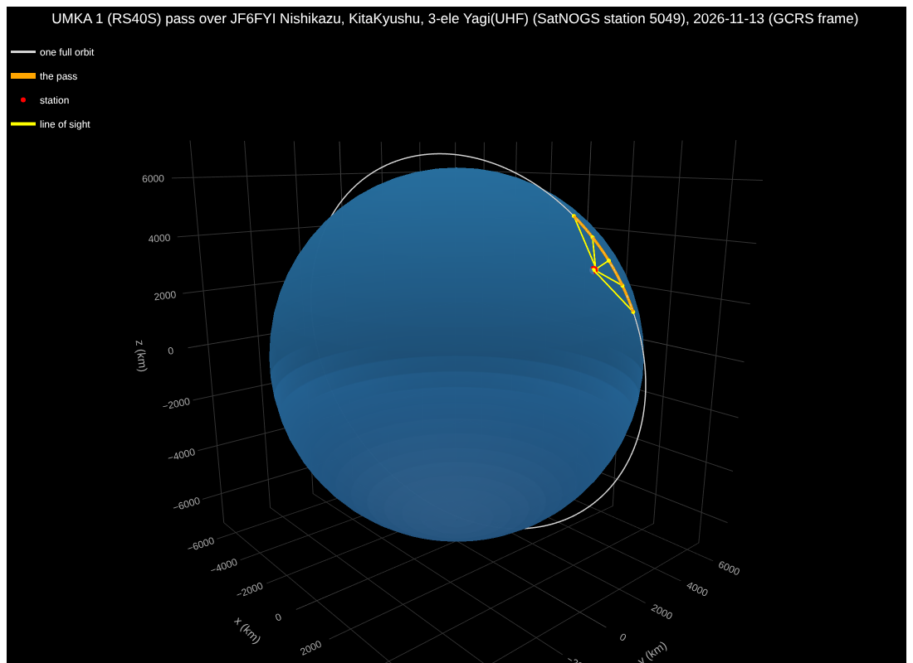
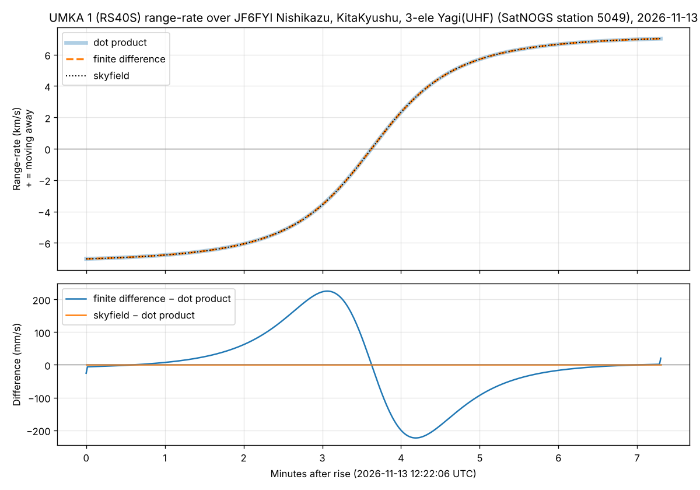
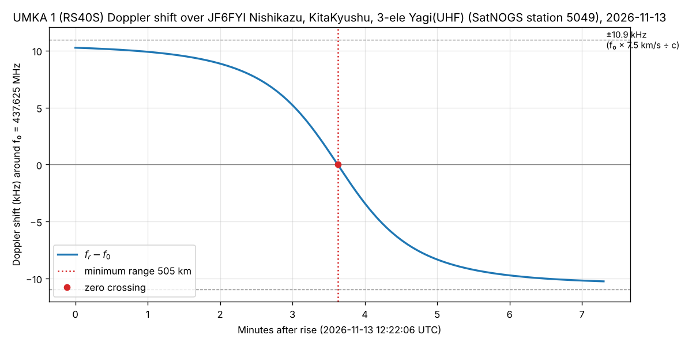
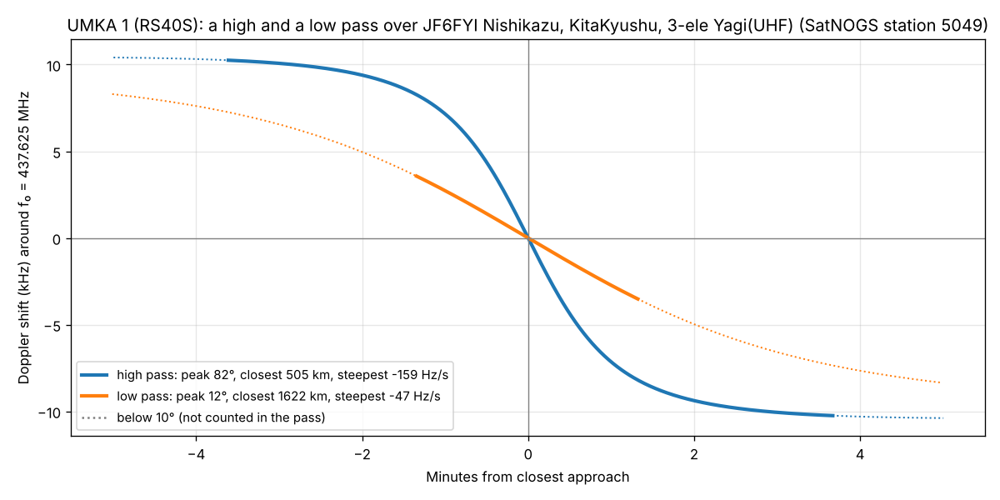

# Week 3: work in 3D and compute the Doppler shift

## The pass

`python doppler_pass.py --stretch` was run on 2026-11-08 at 23:15 UTC with a CelesTrak
TLE 0.65 days old (epoch 2026-11-08 07:38:49 UTC). It used the same station as Week 2,
SatNOGS 5049 in Kitakyushu, and took the highest pass in the next 7 days:

| | |
|---|---|
| Rise | 2026-11-13 12:22:06 UTC (21:22 in Japan) |
| Peak elevation | 82.3° |
| Duration above 10° | 7.3 minutes |
| Range | 1,706 km at rise, **505 km at closest approach**, about the same at set |
| Beacon | f₀ = 437.625 MHz |

## Vectors in 3D

For every second of the pass, `state_vectors()` gets four 3D vectors from skyfield:
`satellite.at(t)` and `station.at(t)`, each with `.position` and `.velocity`. They are
converted to meters and m/s straight away, so the speed of light (in m/s) can't be mixed
with kilometers by accident.

All four are in the **GCRS** frame: centred on the Earth, with axes that point at fixed
stars instead of turning with the Earth. In this frame the station is moving too. At 34°
latitude the Earth's spin carries it east at about 0.39 km/s, which is the "station
speed" arrow in the plan's diagram.



The interactive version is `data/plots/pass3d_57172_5049.html`; open it in a browser to
spin and zoom. It shows the Earth (blue), one full orbit (white), the pass itself
(orange), the station (red) and the line of sight at five moments during the pass
(yellow). The camera looks from beside the orbit plane, so the orbit shows as a ring.

## Range-rate, three ways

ρ is the arrow from the station to the satellite, ρ = r_sat − r_station, and the range is
its length |ρ|. Range-rate ρ̇ is how fast the range is changing: negative while the
satellite approaches, positive once it moves away.

1. **By hand, with the dot product:** ρ̇ = (ρ / |ρ|) · (v_sat − v_station). This keeps
   only the part of the relative velocity that points along the line of sight
   (`range_rate_dot()`).
2. **By finite difference:** the change in range between samples, divided by the time
   step. `np.gradient` uses (r[i+1] − r[i−1]) / 2 s inside the pass
   (`range_rate_finite_difference()`).
3. **With skyfield:** `(satellite - station).at(t).frame_latlon_and_rates(station)`. The
   sixth value it returns is range-rate (`range_rate_skyfield()`).



The three curves lie on top of each other, going from −7.02 km/s at rise to +7.02 km/s at
set. The lower panel shows how far apart they are, in **millimeters** per second:

| Method | Largest difference from the dot product |
|---|---|
| skyfield | 0.00000000001 m/s (rounding error: it uses the same formula) |
| finite difference | **0.23 m/s**, just before and after closest approach |

The finite-difference error is real and expected. A centred difference over 2 seconds
can't follow a curve that bends quickly, and range-rate bends fastest near closest
approach. Halving the step to 0.5 s would make the error about 4 times smaller.

**A bug found on the way.** The first version showed a jagged sawtooth of about ±0.1 m/s
in the finite difference. The cause was the time, not the physics: a Julian date like
2461357.5 stored as one number is only precise to about 40 microseconds, and the
satellite moves about 30 cm in that time. Passing skyfield the date as a whole day plus a
fraction (`times_after()`) removed it. `predict_passes.py` now does the same.

## The Doppler curve

The received frequency is f_r = f₀ (1 − ρ̇ / c), and the shift is f_r − f₀.



- At rise, the satellite is coming toward the station at 7.02 km/s, so the beacon arrives
  **10,252 Hz high**.
- At set, it is moving away just as fast, so the beacon arrives **10,249 Hz low**.
- In between, the shift slides through zero at closest approach. That is the car-horn
  effect from Week 1: higher while approaching, lower while leaving.

**Checkpoint: PASS.**
- **The three range-rate curves agree to within about 1 m/s.** The largest difference is
  0.23 m/s (finite difference).
- **The Doppler curve crosses zero at the moment of minimum range.** Both happen 217.5 s
  after rise (12:25:43.4 UTC), within 0.1 s of each other. At closest approach the
  satellite moves sideways across the line of sight, so none of its velocity points
  toward or away from the station.
- **The peak shift is close to f₀ × 7.5 km/s ÷ c = 10,948 Hz.** It is 10,252 Hz, 0.94 of
  that. It is a little less because even at 10° elevation the satellite isn't heading
  straight at the station, so not all of its speed is along the line of sight.
- **The sign is right:** the curve starts high and ends low. The plan's "flipped sign"
  mistake would make it start low.

## Stretch: a high pass and a low pass



Both curves are lined up at closest approach and drawn over the same 10 minutes. The
solid part is where the satellite is above 10° (the pass itself); the dotted part is
below that.

| | High pass | Low pass |
|---|---|---|
| Rise (UTC) | 2026-11-13 12:22:06 | 2026-11-09 00:02:52 |
| Peak elevation | 82.3° | 11.6° |
| Closest approach | **505 km** | **1,622 km** |
| Largest shift above 10° | 10,250 Hz | 3,565 Hz |
| Fastest change (at closest approach) | **−159 Hz/s** | **−47 Hz/s** |

**Why the high pass flips faster.** On a high pass, the satellite flies almost straight
over the station and comes within 505 km. Close up, a small move along the orbit swings
the line of sight through a large angle. The satellite goes from "mostly coming toward
you" to "mostly going away" in about two minutes.

On a low pass, the satellite stays far off to one side, never closer than 1,622 km. From
that far away the line of sight turns slowly, so the shift changes slowly.

Near closest approach the rate of change is about −(f₀ / c) × v² / ρ_min, where v is the
relative speed and ρ_min the closest distance. So it is inversely proportional to the
closest distance. The low pass is 1,622 / 505 = 3.2 times further away, and its curve
is 159 / 47 = 3.4 times gentler; the small difference comes from v being slightly
different on the two passes.

The low pass's shift above 10° never gets near ±10 kHz either. While it's above 10° the
satellite is far away and moving mostly sideways across the sky, not toward the station.

## Running it

```bash
python doppler_pass.py                    # highest UmKA-1 pass over station 5049
python doppler_pass.py --stretch          # also the high vs low pass comparison
python doppler_pass.py --tle-file my.tle --start 2026-11-08T23:15:17   # reproduce this run
python doppler_pass.py --norad 59112 --freq-hz 145840000   # SONATE-2 on 2 m (expect ~±3.5 kHz)
```

The station and window options are the same as Week 2's `predict_passes.py`. The plots
are saved to `data/plots/`: `range_rate_*.png`, `doppler_*.png`, `pass3d_*.html` and,
with `--stretch`, `doppler_high_low_*.png`.

If CelesTrak or SatNOGS can't be reached from your machine, the
`Week 3 - 3D view, range-rate and Doppler shift` GitHub Actions workflow runs the script
with `--stretch` whenever `doppler_pass.py` changes. The results are in the job log and
the `week3-results` artifact, which includes the interactive 3D view. The plots above
were remade offline from that run's printed TLE lines and start time, and give the same
numbers.
